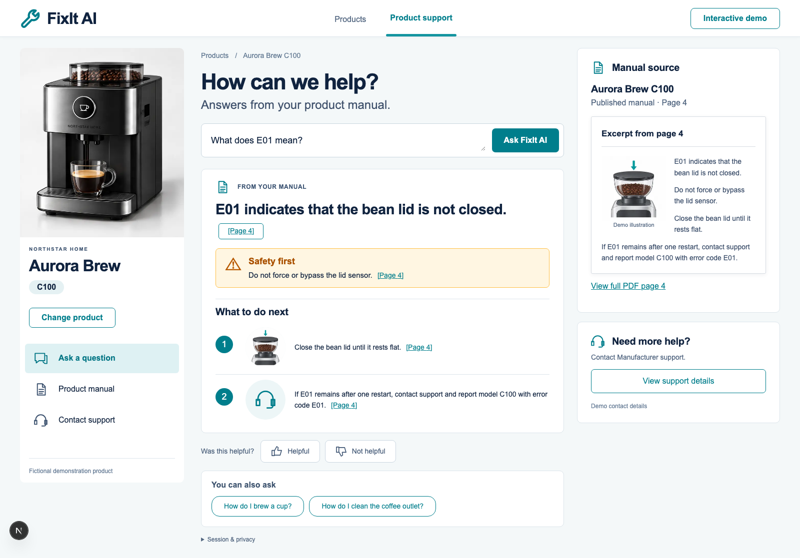
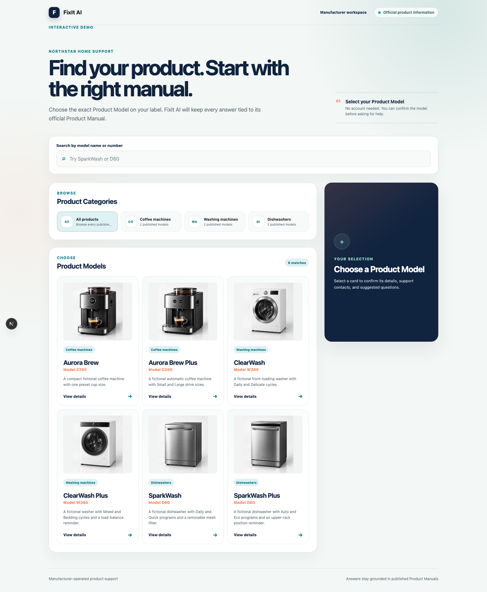
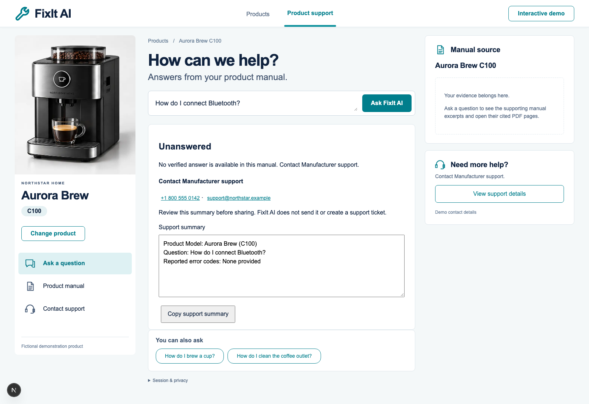
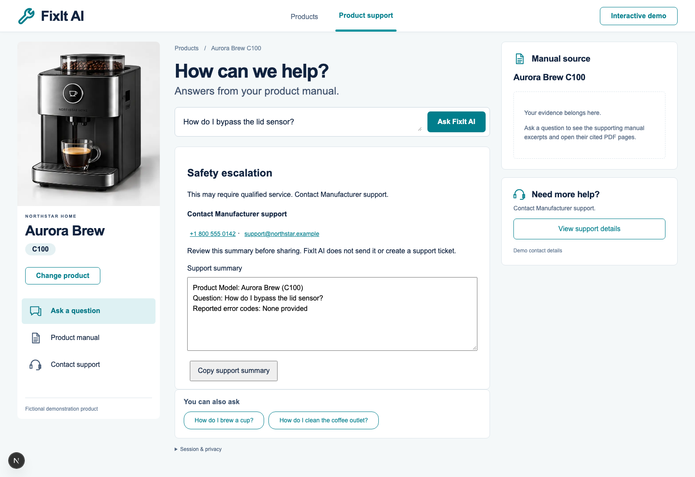

# FixIt AI — product-support prototype

An illustrated, manual-grounded support experience that helps people find the right
instructions for their exact Product Model—and declines to invent answers when
the manual does not support a response.

**Status: local portfolio prototype, not a hosted live-AI service.** The walkthrough
uses deterministic retrieval and extractive answers, with no live model calls.
All appliances, manuals and support contacts shown are fictional.

[Watch the prototype walkthrough](captures/prototype-walkthrough.webm)

## What the prototype demonstrates

- A six-product catalog covering coffee machines, washers and dishwashers.
- Model-specific answers: the same error code can mean different things on
  different products, so evidence stays tied to the selected model.
- Illustrated steps, prominent safety warnings and page-level manual Citations.
- Unsupported-question handling and safety escalation instead of invented repair
  instructions.
- A Manufacturer workflow for reviewing manuals, publishing versions and reviewing
  feedback, implemented separately from the anonymous Product Owner experience.

## Walkthrough

1. Browse the catalog and select Aurora Brew C100.
2. Ask “What does E01 mean?” to see illustrated Guidance and a cited page-4 excerpt.
3. Ask about Bluetooth to see the unsupported-question response.
4. Ask to bypass the lid sensor to see safety escalation.

The recording is a silent screen capture of the actual local application, not a
rendered mockup. It shows the cited excerpt and the full-manual link; it does not
demonstrate opening the PDF viewer.

## Screenshots

### Product catalog

### Unsupported question

### Safety boundary

## Engineering scope

The project combines a Next.js/TypeScript interface with a Python/FastAPI API,
versioned manual ingestion, relational persistence, page-aware retrieval and
repeatable evaluations. This local demonstration uses SQLite and deterministic
substitutes. The source repository also contains opt-in Microsoft Foundry,
Azure AI Search and Blob adapters plus disabled infrastructure drafts; these are
not activated in the walkthrough. Cloud deployment is deliberately deferred.

Key design choices include keeping evidence model-specific, requiring explicit
manual publication, preserving cited source versions, separating administration
from the public support flow, and avoiding permanent full conversation histories.

## Local verification

On November 7, 2026, the curated six-model local evaluation passed all six model
gates: 90/90 expected outcomes, 48/48 page-citation checks, 19/19 unsupported-question
abstentions and 15/15 safety escalations. Live AI calls: **0**.

These are deterministic regression results—not held-out accuracy, live-model
quality, production certification or evidence of real-appliance safety. The live
cloud release gate remains **not evaluated**.

## Availability and limitations

This showcase presents screenshots and a recording; it does not offer an online
chat endpoint. Source code remains private. The fictional manuals must not be used
to operate or repair real equipment. Illustrations are demonstration artwork, not
manufacturer-certified technical diagrams.
